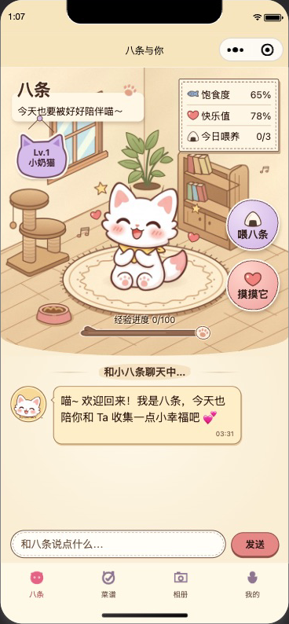
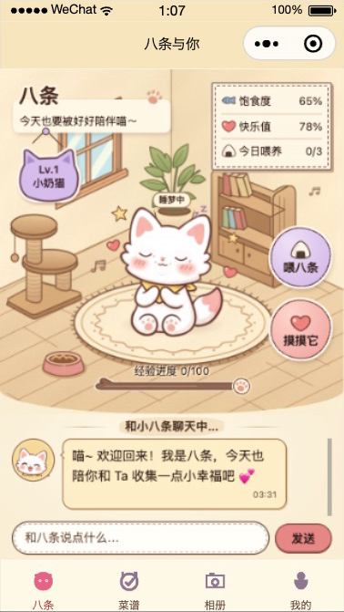
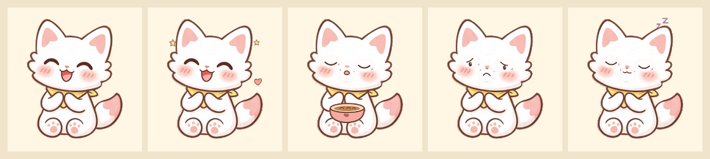

# 八条首页 · 原型还原评审

本轮以 [`1.jpg`](../new/1.jpg) 为视觉基准，范围是八条首页和 Lv.1 小奶猫。以下是当前实现，目录里带 `draft` 或 `room-preview` 的举爪图为上一轮草稿。

## 首页截图

**390 × 844 · 白天陪伴**（使用模拟器临时预览状态，未写入养成数据）

**320 × 568 · 夜间睡梦**（按本地时间自然进入）

八条保留原型的坐姿、弯眼笑脸、黄领巾、合拢的前爪和粉色肉垫。房间按参考图绘制了窗、猫爬架、植物、书柜、地毯及粉色食盆，提供[可编辑的房间插画源图](batiao-room-source.svg)。等级牌、状态卡、喂食和摸摸圆按钮、经验条及聊天区均用小程序组件搭建，数值和按钮仍由原有业务驱动。

## Lv.1 五态

| 状态 | 画面 |
| --- | --- |
| 陪伴中 | 原型坐姿与弯眼笑脸 |
| 开心 | 同一坐姿，增加星星和爱心 |
| 吃得香 | 闭眼咀嚼，双爪捧着粉色食盆 |
| 需要安慰 | 垂眉、湿润眼睛与抿嘴 |
| 睡梦中 | 闭眼、放松嘴角和 Z 字贴纸 |

喂食和摸摸会触发短时状态，切走再回到首页仍按动作原有截止时间恢复。Lv.2–4 素材、原生导航、喂养与升级规则保持原样。

## 验证范围

微信开发者工具验证了两个尺寸的首页渲染，窄屏的消息、输入框、发送按钮均可见。12 个离线冒烟脚本、静态检查和素材体积检查均通过。尚未做手机真机键盘和手势联测。
