# 八条与你 · 现有界面与重设计交接

**版本：** v1.4.0　**截图日期：** 2026-11-18　**覆盖：** 13/13 个已注册页面，20 张截图

这是给 UI 和前端的**现状参考**，不是新设计稿。截图来自当前项目在微信开发者工具中的实际运行画面（iPhone 12/13 Pro 模拟器，基础库 3.4.3）。只裁掉了开发工具外框，并遮挡绑定页的本机邀请码和资料页的纪念日值；未重绘界面。部分版面裁字和重复导航是现状，不是设计要求。

> **转发方式：** 发送交接 ZIP，解压后打开本 Markdown。请将 Markdown 与同级 `screenshots/` 目录一起保留；只发送 `.md` 会丢失图片。

## 页面索引

| 编号 | 页面 | 进入路径 | 截图状态 |
|---|---|---|---|
| 01 | [八条](#01-八条) | 底部 Tab：八条 | Lv.1 陪伴中、欢迎消息 |
| 02 | [菜谱图鉴](#02-菜谱图鉴) | 底部 Tab：菜谱 | 未解锁、已解锁为空、甜品区 |
| 03 | [我们的相册](#03-我们的相册) | 底部 Tab：相册 | 未绑定且无照片、签名编辑中 |
| 04 | [我的](#04-我的) | 底部 Tab：我的 | 未绑定、成长统计与设置入口 |
| 05 | [菜品详情](#05-菜品详情) | 菜谱 → 点击菜品卡片 | 辣椒炒肉，未解锁 |
| 06 | [添加与编辑菜品](#06-添加与编辑菜品) | 菜谱 → 新增；详情 → 编辑 | 新建空表单、编辑已有菜品 |
| 07 | [上传照片](#07-上传照片) | 相册 → 上传第一张 / 上传照片 | 未选图的上传表单 |
| 08 | [编辑资料](#08-编辑资料) | 我的 → 编辑 | 头像、资料、日期与签名表单 |
| 09 | [情侣绑定](#09-情侣绑定) | 我的 → 生成 / 输入邀请码；相册 → 邀请 Ta | 未绑定，生成与输入邀请码 |
| 10 | [设置与隐私](#10-设置与隐私) | 我的 → 设置与隐私 | 开关、入口列表、清除确认弹窗 |
| 11 | [关于八条与你](#11-关于八条与你) | 我的或设置 → 关于八条与你 | 产品介绍、当前模式、反馈入口 |
| 12 | [隐私说明](#12-隐私说明) | 设置 → 隐私说明 | 首屏与滚动至底部 |
| 13 | [意见反馈](#13-意见反馈) | 设置 / 关于 / 隐私说明 → 反馈 | 空表单、无本地反馈记录 |

## 01 八条

路由：`pages/chat/chat`。首屏同时承载猫咪状态、喂养与抚摸、经验进度和聊天。重设计时请明确首屏主操作，给聊天列表和键盘弹出留出空间。

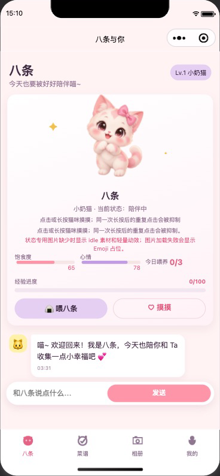

## 02 菜谱图鉴

路由：`pages/recipe/recipe`。三种分类共用同一页；重设计请区分未解锁卡、带图卡、已解锁空态，并避免悬浮新增按钮遮挡卡片信息。

**未解锁：** 默认菜谱列表。

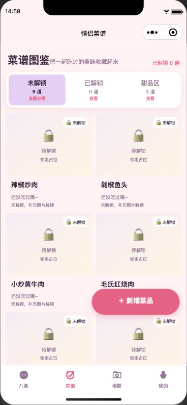

**已解锁：** 本次无已解锁菜品。

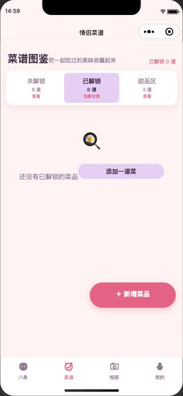

**甜品区：** 甜品卡仍可处于未解锁状态。

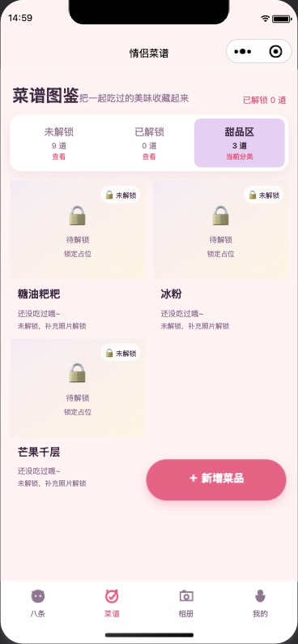

## 03 我们的相册

路由：`pages/album/album`。顶部包含伴侣头像、邀请、照片数和签名。当前空态同时出现「上传第一张」和悬浮「上传照片」，设计时可统一主入口。

**未绑定、无照片：**

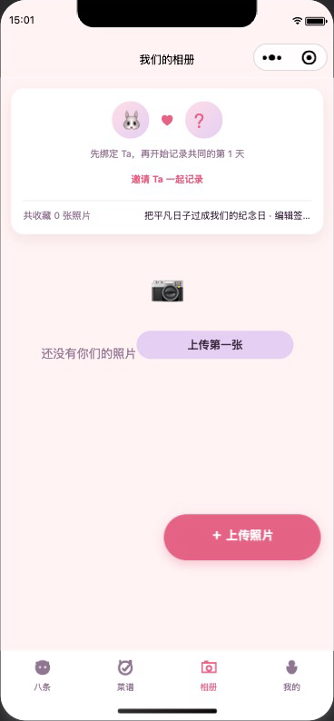

**签名编辑：** 在同页展开输入和保存 / 取消按钮。

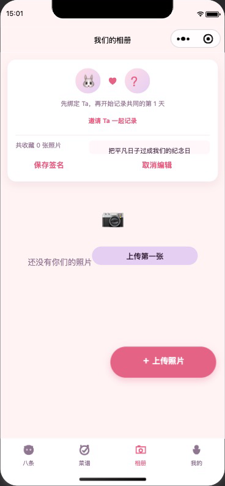

## 04 我的

路由：`pages/profile/profile`。同页包含个人资料、情侣关系、八条成长和设置。首屏与滚动后是同一路由。

**首屏：**

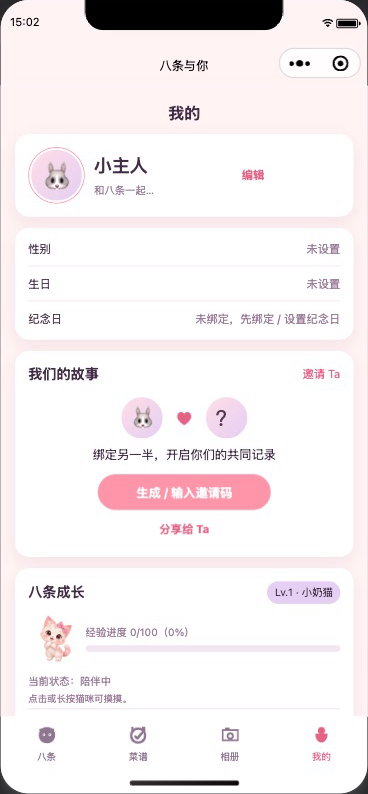

**下半屏：** 当前等级、经验、统计、下一形态目标和设置入口。

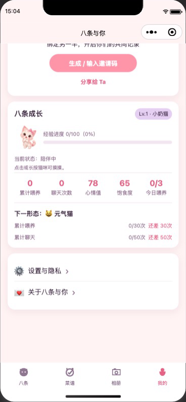

## 05 菜品详情

路由：`pages/recipe-detail/recipe-detail`。未解锁时可补充照片；解锁后才显示评分和点赞能力。当前「补照片解锁」提示出现多次，建议合并为清楚的一条说明和一个操作。

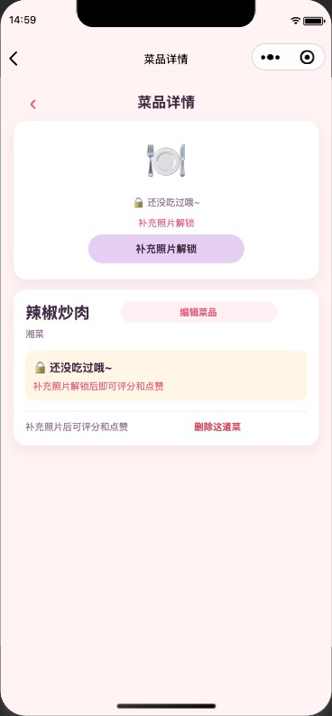

## 06 添加与编辑菜品

路由：`pages/recipe-add/recipe-add`。新增与编辑复用同一表单。菜名可先保存，之后再补照片解锁；最多添加 9 张。现状截图里「添加照片」字样被裁切，出稿时请明确选图格尺寸、字号和换行方式。

**添加新菜：**

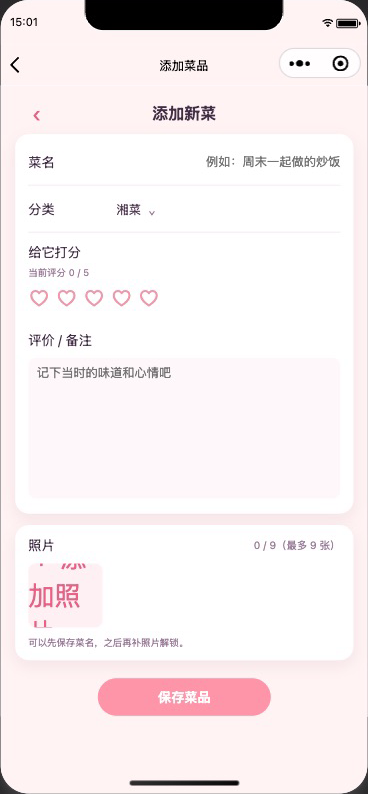

**编辑菜品：** 已带入菜名与分类。

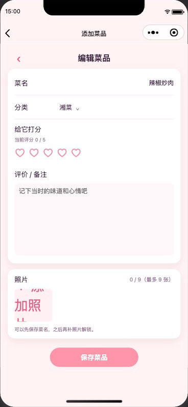

## 07 上传照片

路由：`pages/album-upload/album-upload`。包含最多 9 张的选图区域、日期、描述、标签和「保存回忆」。本次只截取未选图表单；此版本保存到本设备，不是上传到云端。

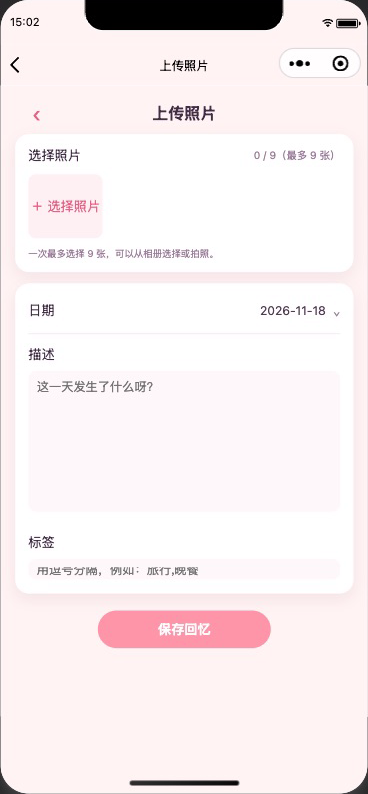

## 08 编辑资料

路由：`pages/profile-edit/profile-edit`。包含头像、昵称、性别、生日、在一起的日子、签名。纪念日值已遮挡，日期字段与选择入口保留。

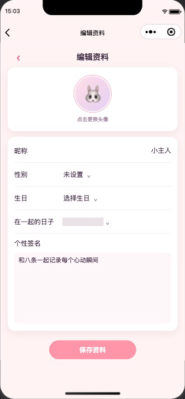

## 09 情侣绑定

路由：`pages/bind/bind`。页面分为「把我的邀请码给 Ta」与「输入 Ta 的邀请码」两条路径；当前仅本机模拟。邀请码已遮挡。现状里输入框占位文字被裁切，重设计时请补齐未填、无效和已填待确认状态。

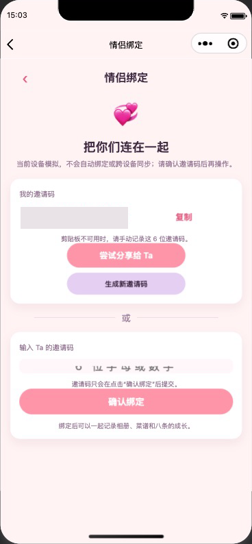

## 10 设置与隐私

路由：`pages/settings/settings`。两项提醒开关均为本地功能，不是微信通知授权。页面还有关于、隐私、反馈和清除本地数据入口。

**设置页：**

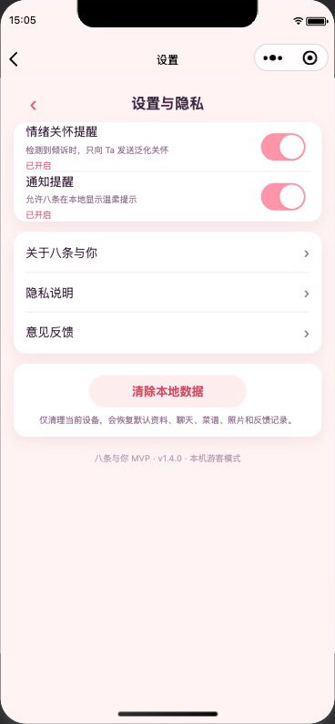

**清除确认：** 只打开弹窗后取消，未清除数据。

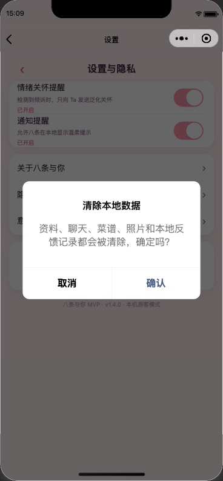

## 11 关于八条与你

路由：`pages/about/about`。介绍四个模块，说明版本、当前本地模式与反馈保存方式。

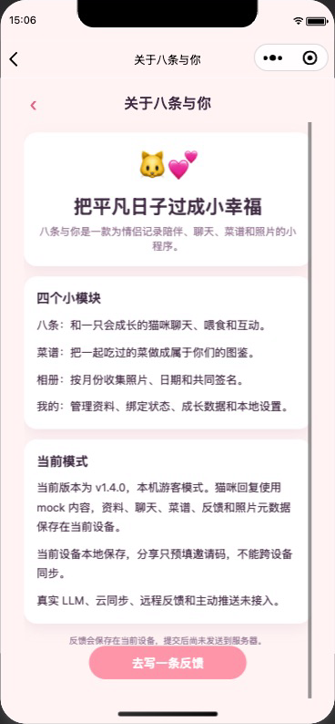

## 12 隐私说明

路由：`pages/privacy/privacy`。说明本地存储、情绪关怀、功能限制与数据清除。首屏下方操作未完整露出，滚动后可见「反馈隐私疑问」。重设计请验证底部安全区和长文滚动。

**首屏：**

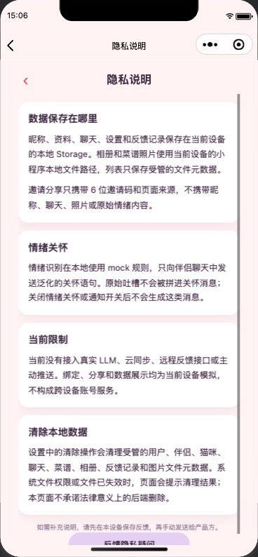

**滑到底部：**

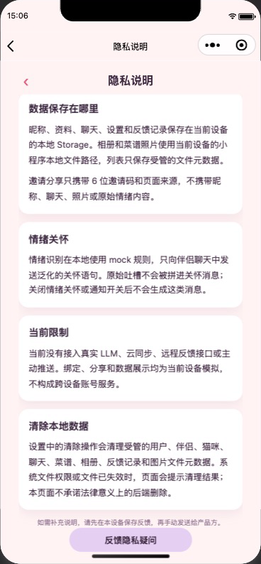

## 13 意见反馈

路由：`pages/feedback/feedback`。包括分类、5–500 字内容、可选联系方式和本地记录。保存不等于已提交到服务器。现有可选联系方式的占位文字被裁切，重设计时请检查表单行高。

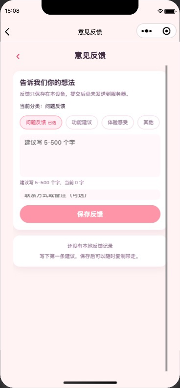

## 给 UI 和前端的重设计要求

1. **统一导航和组件。** 部分二级页现在同时显示微信原生导航和页面内的标题、返回按钮，请区分原生区域与自定义区域。统一按钮层级、表单行高、字号、间距、空态与图片占位；标出小屏、键盘和底部安全区的处理方式。
2. **按业务流程出稿，不只改默认首屏。** 优先覆盖八条互动和聊天、菜品从未解锁到解锁、相册从空态到有图、邀请码输入与确认。截图未覆盖的状态包括：其他猫咪形态与互动反馈、已有聊天、带图菜品与评分点赞、非空相册与照片预览、绑定后/解绑、本地反馈记录，以及加载、保存失败、无权限、图片失效状态。请把这些状态作为设计补充，不要理解为都已经过本轮运行验证。
3. **保持 v1.4 功能边界。** 聊天是本地模拟回复，绑定仅当前设备模拟，反馈只保存在本地。不要把跨设备共享、真实 AI、云反馈或推送写成现有能力。真机选图、系统相册权限和系统分享面板不在本次截图范围内。
4. **回传可落地的稿件。** 请按 01–13 编号回传 Figma 链接或源稿，并附每页 PNG 预览、关键状态稿、公共组件样式（颜色、字体、间距、圆角）和需要导出的图标/插图。涉及入口、字段、文字或交互变化时请单列说明，方便后续逐页改造和对照验收。
