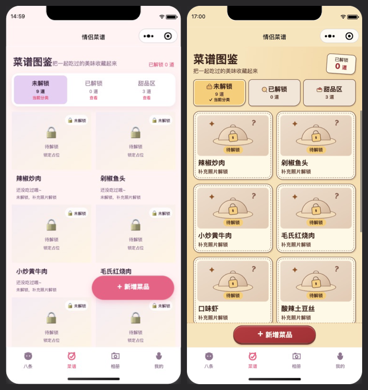
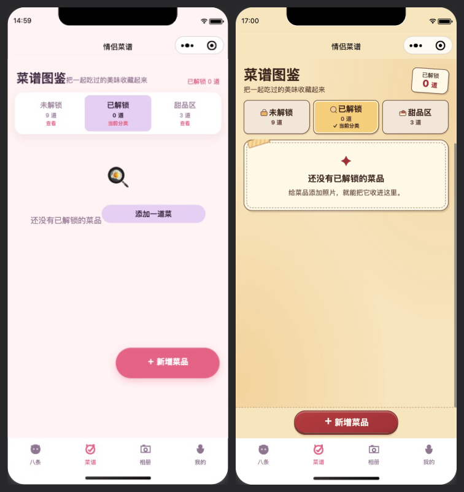
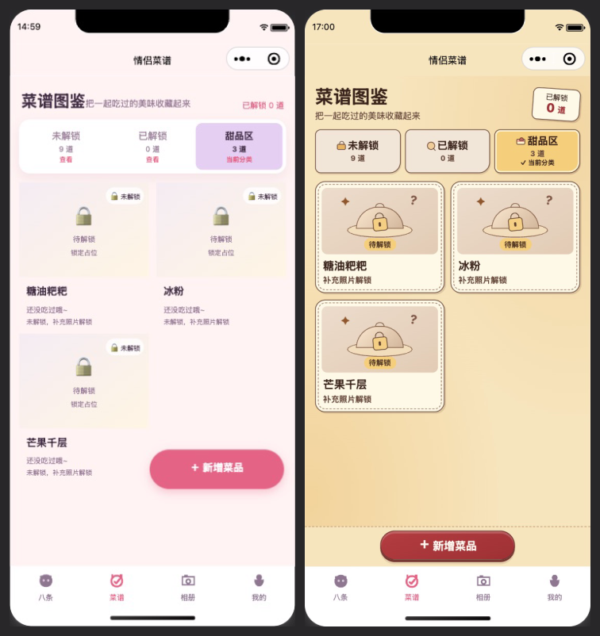
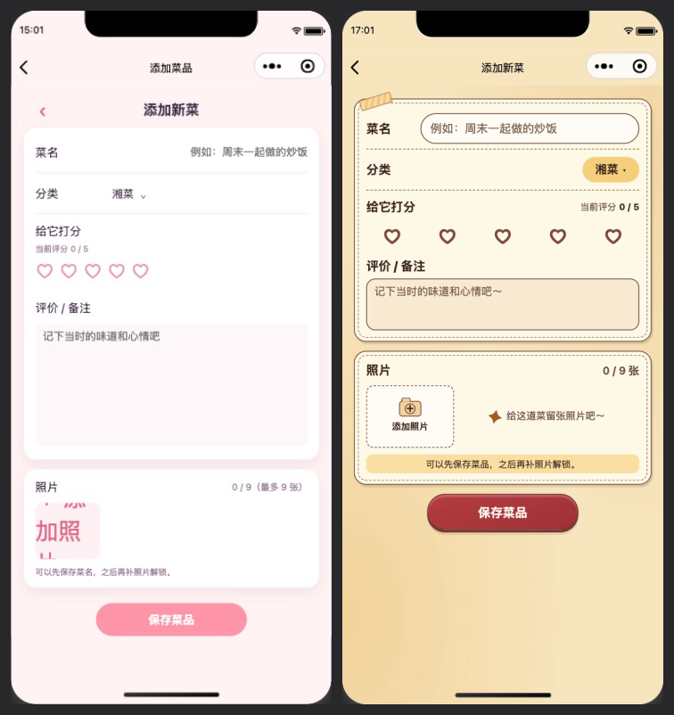
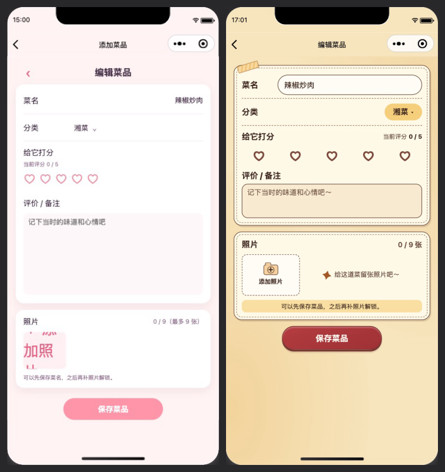
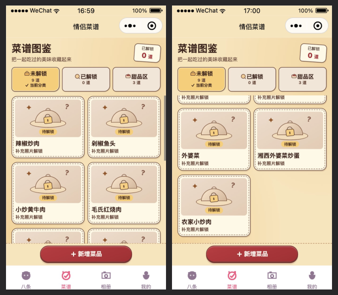
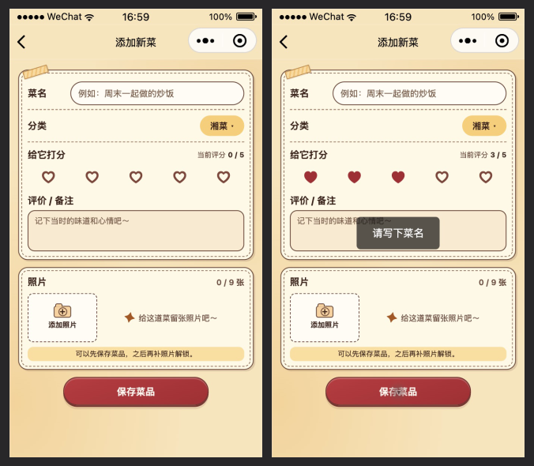

# 八条与你 · A 批菜谱试做评审

**2026-11-18｜供前端与 UI 评审，不代表发版验收。** 本轮只改 02 菜谱图鉴和 06 新增／编辑菜品。原型对应 `docs/new/2.jpg`（图鉴）、`5.jpg`（编辑）、`6.jpg`（新增）。未把整页原型或新 IP 素材放进小程序包；本地记录、存储结构、路由、四个 Tab 和解锁规则保留。

## 02 · 菜谱图鉴

以下五组均为微信开发者工具实拍，**左侧是旧版，右侧是试做版**。对照图均使用 iPhone 12/13 Pro（390 × 844 逻辑像素），只截取手机画面。

### 未解锁

分类保留动态计数，用「✓ 当前分类」区分选中态。待解锁卡片统一用餐盖、锁图和明确的补照片提示。新增按钮在滚动区外，不浮在卡片上。

### 已解锁为空

空态明确解释照片与「已解锁」的关系，底部只保留一个新增入口。

### 甜品区

沿用原来的独立筛选规则，不把甜品当成另一种解锁状态。截图中的 `9 / 0 / 3` 是本次运行数据，不写死在界面里。

## 06 · 新增／编辑菜品

两个入口共用同一表单。保留原生导航，去掉内容区重复的标题与返回。照片格用图标加短标签解决旧版裁字；评分用空心与实心区分，并保留数字读数。

### 新增：空菜名、零分、无照片

### 编辑：预填既有菜品

从「辣椒炒肉」卡片进入详情，再点「编辑菜品」。示例为未解锁菜品，显示已有菜名、原分类及 `0 / 9 张`。

## 窄屏实测

使用 iPhone 5（320 × 568 逻辑像素）检查了按钮的原生默认宽度。修正后，双列不重叠、不越界；滚至底部能完整看到最后一张「农家小炒肉」卡片。

选第三颗心后，显示三颗实心、两颗空心和 `3 / 5`。空菜名点击保存时提示「请写下菜名」，页面不跳转。照片入口的文字完整可读。

## 验证记录

| 检查项 | 结果 | 证据与边界 |
|---|---|---|
| 分类切换、动态计数、空态、滚动到底 | 模拟器通过 | 微信开发者工具 Stable `2.02.2608070`，基础库 `3.4.3`；覆盖 390 和 320 宽度。 |
| 新增入口、详情到编辑、预填、原生返回、评分、空名校验 | 模拟器通过 | 既有菜品未修改，试做时未保存模拟器里的表单。 |
| 无图保存、补图解锁、已解锁筛选、编辑带图数据 | 离线测试通过 | 通过 `wx` 回调模拟和独立测试数据验证；不是系统选择器或实际照片文件实测。 |
| 照片 1/9 张、满 9 张拒绝再选、坏图占位、保存失败与回滚 | 离线测试通过 | 选图计数、错误回调和新增保存失败分支有断言；尚未取得这些状态的模拟器截图。 |
| 模拟器选图 | 部分验证 | 文件选择器能打开并取消；选择本机测试 PNG 后仍为 `0 / 9 张`，未确认选图成功或失败原因。需要用真机验证后再判断是否为开发工具问题。 |
| 真机、系统权限、键盘遮挡、连续快速保存 | 未验证 | 下一轮优先验证 iOS/Android 的相册与相机、1/9 张保存后返回图鉴、拒绝权限、长输入与键盘、保存中连续点击。 |
| 工程检查 | 通过 | 12 个冒烟脚本全部通过，页面脚本 118 条断言；静态检查 0 错误、0 警告；63 个 JS、50 个 JSON 校验通过。 |
| 资源预算 | 通过 | `miniprogram/` 源文件合计 `1,653,454 B`，较基线增加 `13,769 B`，距仓库 `2,097,152 B` 预算还有 `443,698 B`；不是微信上传后的实测包体。 |

## 本轮请确认

1. **整体视觉**：奶油纸色、深棕描边、暖黄选中和珊瑚红主按钮是否作为后续页面基调？边框、虚线和胶带的装饰程度是否合适？
2. **页面结构**：是否保留图鉴的双列密度与独立底部操作区，以及表单的「基本信息／照片」两段布局？

视觉方向确认后再开始 B 批：八条首页、相册、我的、上传照片。新角色 IP 不在本轮上线范围，选图与真机问题单独复核。
