# 八条与你 · 全量 UI 改版评审

**2026-11-18｜A 批视觉已确认，B / C 批已实现，待真机验收。** 本包包含 13 个页面的新版截图、关键状态和旧版对照，可直接转发给前端与 UI。解压后打开 `review.md`，请保留同级图片目录。

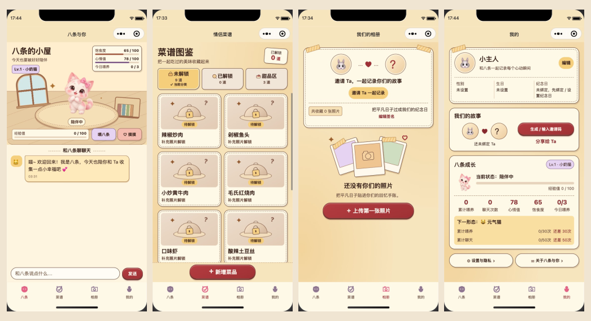

## 本轮范围

- 延续菜谱试做的暖色手账风格：奶油纸底、深棕文字与描边、珊瑚红主按钮；复用纸卡、表单行、状态标签和占位样式。
- 保留微信原生导航、13 个路由、四个 Tab 和现有图标。首页房间和相册空态用 WXSS 绘制，继续使用八条原有四形态，没有把整页原型或新角色 IP 放进运行包。
- 保留 AppID、基础库、存储结构与养成、菜谱、相册规则。绑定和记录仍是本机模式；不新增云同步或远程反馈。不涉及发布。

## 全量页面截图

新版为微信开发者工具 **Stable 2.02.2608070**、基础库 **3.4.3** 的实际运行截图，常规屏使用 **iPhone 12/13 (Pro)，390 × 844** 逻辑像素，只裁手机画面。常规屏共 19 张，覆盖 13/13 个路由和 6 个补充状态。旧版图来自首次交接；运行时间、数据和设备外观不作为改版差异。另附 4 张窄屏图。

### 01 · 八条首页

`pages/chat/chat` · [查看旧版](before/01-chat.png)

小屋分出角色、状态和养成操作，下方是聊天；经验、心情和饱食显示运行时真实数值。

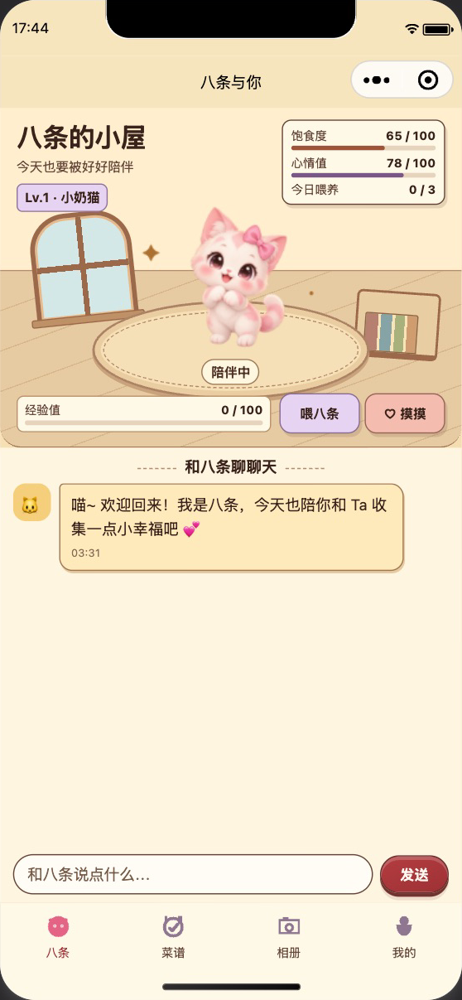

### 02 · 菜谱图鉴

`pages/recipe/recipe` · [查看旧版](before/02-recipe.png)

双列菜谱卡片，分类显示动态计数和选中标记；新增按钮独立于滚动列表。

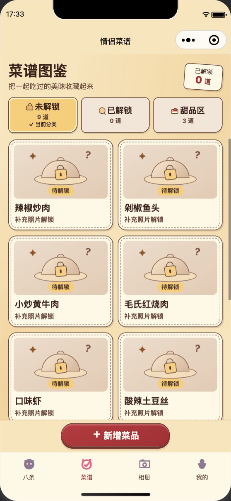

**已解锁空态**

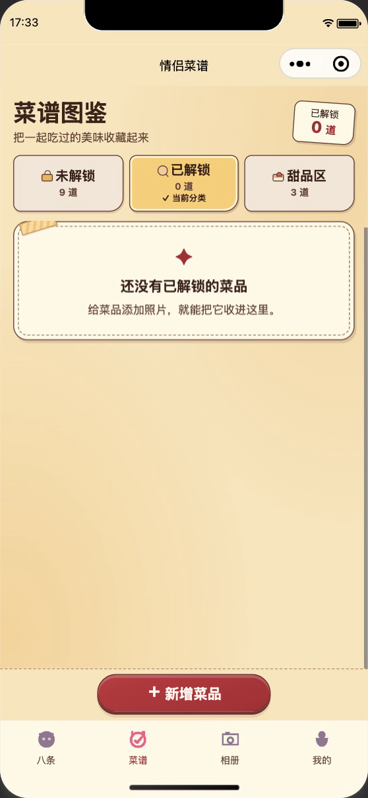

**甜品分类**

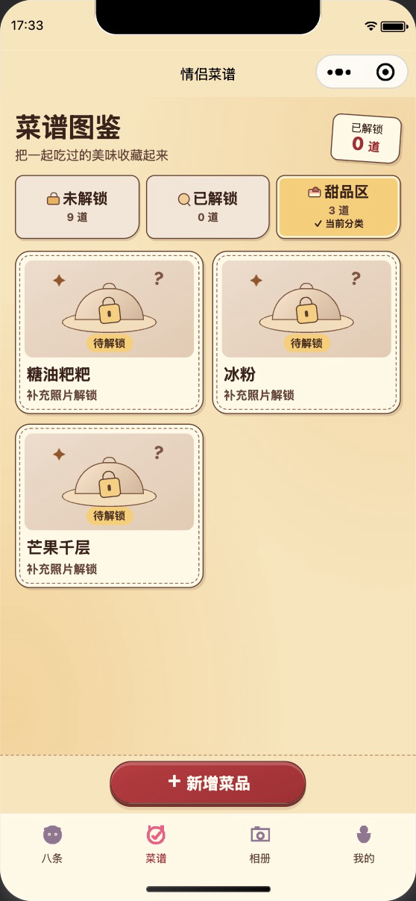

### 03 · 我们的相册

`pages/album/album` · [查看旧版](before/03-album.png)

关系卡、照片数和签名集中展示。无照片时只保留一个上传入口。

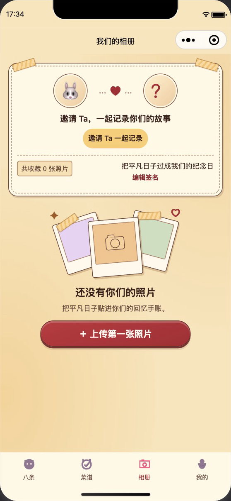

**签名编辑**

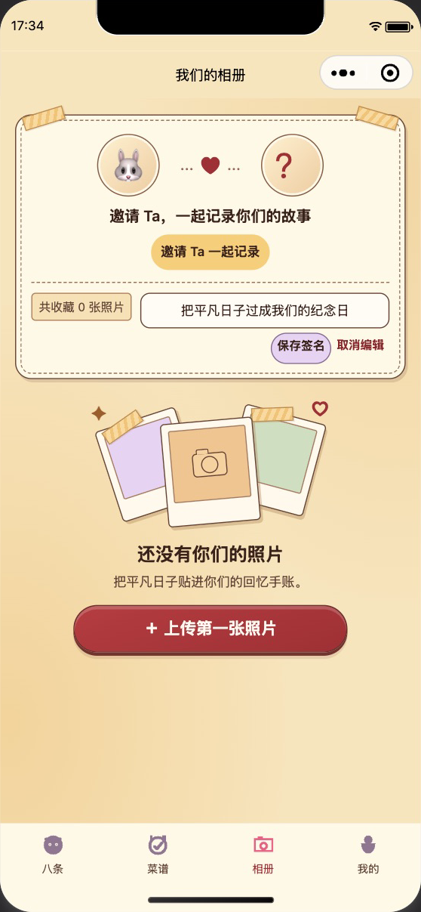

### 04 · 我的

`pages/profile/profile` · [查看旧版](before/04-profile.png)

按资料、关系、成长三段组织，显示已有的等级和升级条件。

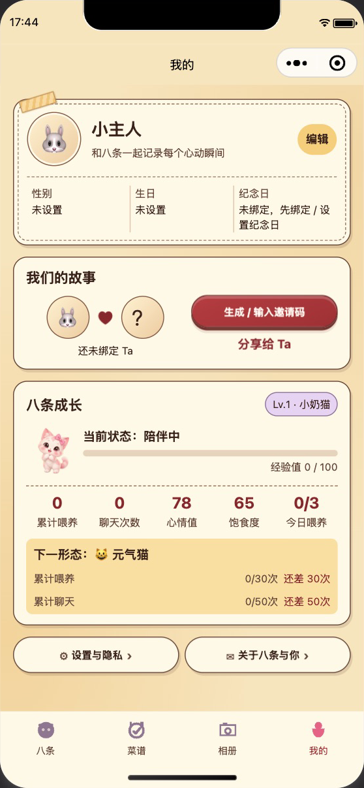

### 05 · 菜品详情

`pages/recipe-detail/recipe-detail` · [查看旧版](before/05-recipe-detail.png)

未解锁时突出补图入口，已解锁后沿用封面、评分、点赞和编辑流程。截图为未解锁状态。

### 06 · 新增／编辑菜品

`pages/recipe-add/recipe-add` · [查看旧版](before/06-recipe-add.png)

基本信息和照片分区；评分同时呈现心形和读数，编辑预填已有信息。

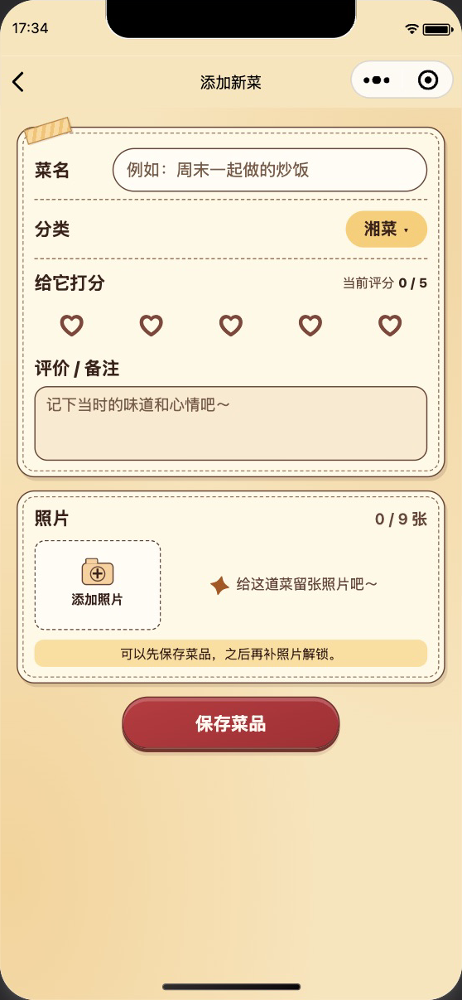

**编辑已有菜品**

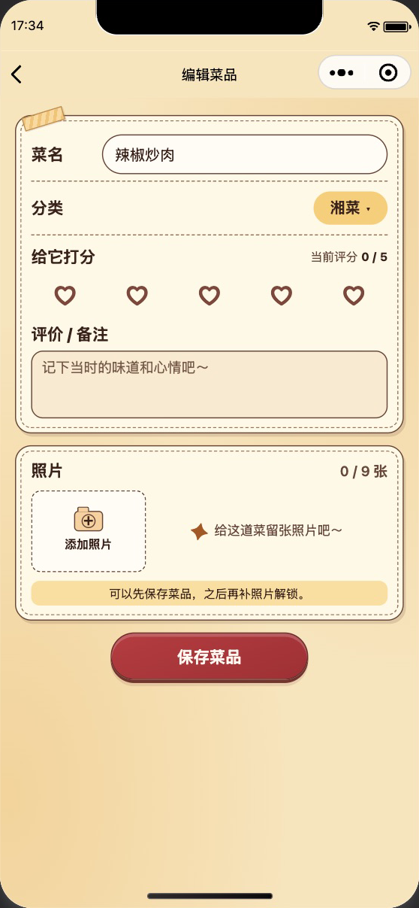

### 07 · 上传照片

`pages/album-upload/album-upload` · [查看旧版](before/07-album-upload.png)

照片网格与日期、描述、标签分区；展示张数上限和本机保存提示。截图为 0 张。

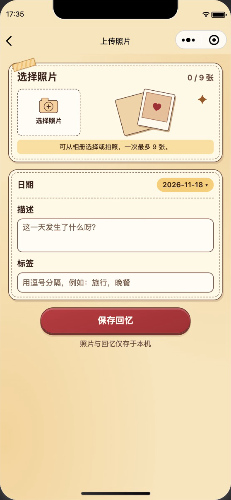

### 08 · 编辑资料

`pages/profile-edit/profile-edit` · [查看旧版](before/08-profile-edit.png)

头像和资料字段分组；保留系统日期选择器。已遮挡纪念日。

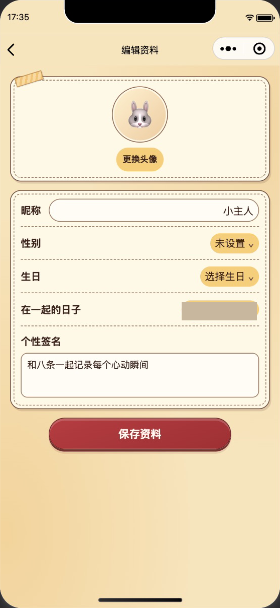

### 09 · 情侣绑定

`pages/bind/bind` · [查看旧版](before/09-bind.png)

我的邀请码与输入对方邀请码分成两张卡，明确绑定是本机模拟。已遮挡邀请码。

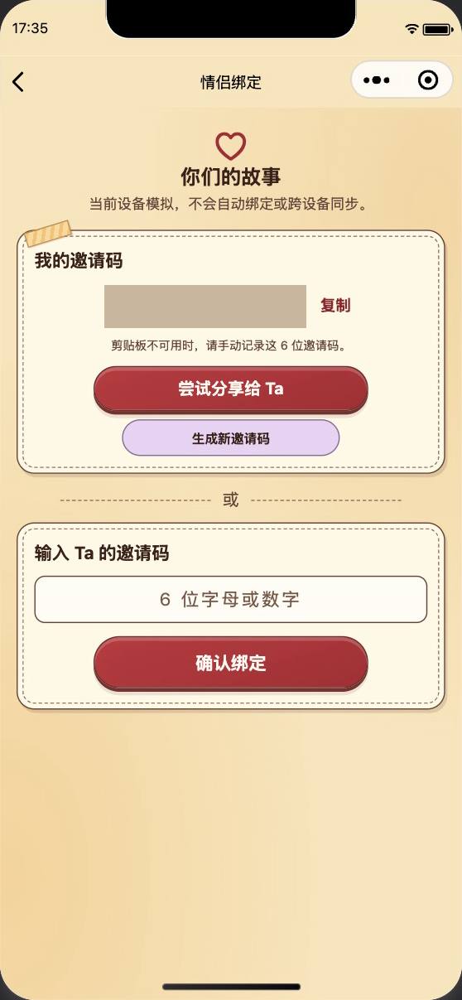

### 10 · 设置与隐私

`pages/settings/settings` · [查看旧版](before/10-settings.png)

开关显示开闭文字；清除本地数据与普通设置分开。走查只展示确认框后取消。

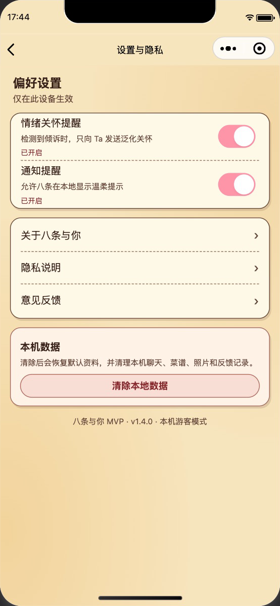

**清除本地数据确认框**

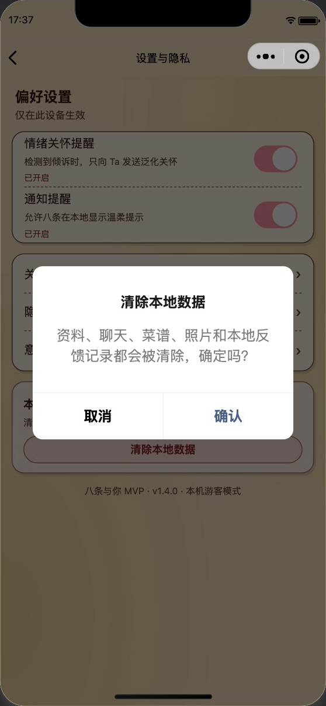

### 11 · 关于八条与你

`pages/about/about` · [查看旧版](before/11-about.png)

用短卡片说明产品、当前模式与限制。

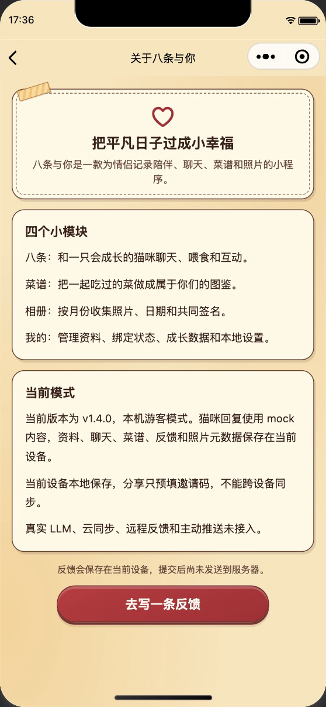

### 12 · 隐私说明

`pages/privacy/privacy` · [查看旧版](before/12-privacy.png)

分段说明本机数据和使用范围；可以滚动到最后的反馈入口。

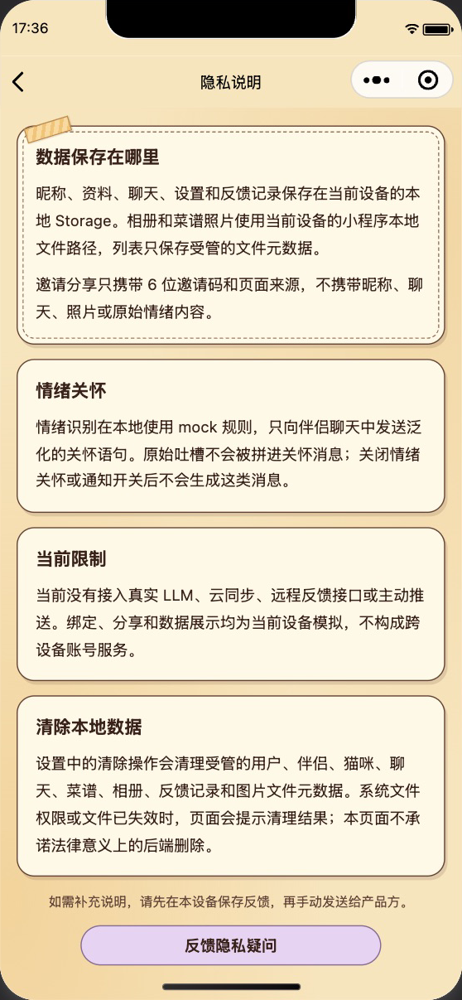

**滚动到隐私说明底部**

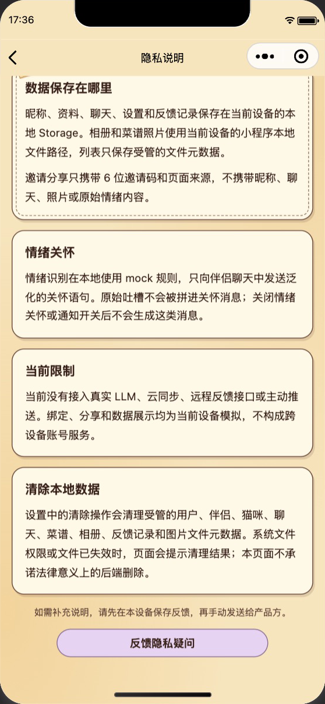

### 13 · 意见反馈

`pages/feedback/feedback` · [查看旧版](before/13-feedback.png)

类型、字数与保存动作更清楚，并提示反馈不会自动发送。

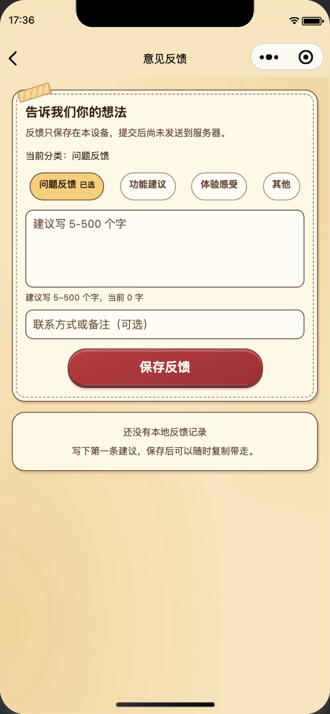

## 窄屏复核 · iPhone 5（320 × 568）

| [八条首页](screenshots/narrow-01-chat.png) | [相册空态](screenshots/narrow-03-album.png) | [我的](screenshots/narrow-04-profile.png) | [上传照片](screenshots/narrow-07-album-upload.png) |
|---|---|---|---|
| 小屋、聊天输入和 Tab 可同时显示。 | 空态插图不遮挡上传按钮。 | 资料和关系入口可见，成长下半区需要纵向滚动。 | 0 张照片、表单和保存入口可见。 |

## 验证记录

| 检查项 | 结果与边界 |
|---|---|
| 页面导航与视觉 | 模拟器走查 4 个 Tab、13 个路由。截图覆盖三种菜谱分类、菜谱编辑预填、相册签名编辑、设置确认框和隐私页滚动。未执行清除，也未保存测试内容。 |
| 养成、输入及错误回退 | 离线通过：同一手势去重、经验变动、状态素材降级、空聊天内容不写入、键盘高度和失焦状态更新。键盘测试只验证事件逻辑，不能证明真机无遮挡。 |
| 菜谱、相册、绑定和反馈 | 离线通过：菜谱有／无图及解锁、上传 0／1／9 张边界与坏图占位、保存失败回滚、绑定／解绑刷新、反馈本地保存等。带图及已绑定等状态不是本次截图实测。 |
| 工程检查 | 12 个 `smoke-*.js` 脚本通过，页面回归脚本 128 条断言通过；静态检查 0 错误、0 警告；JS／JSON 语法及 `git diff --check` 通过。 |
| 资源预算 | `miniprogram/` 源文件合计 **1,662,075 B**，比改版前增加 **22,390 B**，距离仓库 `2,097,152 B` 预算尚余 **435,077 B**。不是微信上传后的实测包体。 |
| 设备能力 | **待真机验收。** 模拟器能打开选图入口，但试做时选择测试 PNG 后未确认得到缩略图，原因未定位。未将离线回调测试算作选图、相机、系统权限、保存本机相册、分享、键盘或长按的真机结果。 |

## 真机验收优先级

1. 用 iOS 和 Android 的测试数据各跑一遍：相册选 1 张及 9 张 → 显示缩略图 → 保存 → 返回分月列表 → 预览；再验证取消和拒绝权限。
2. 从待解锁菜品补图，回图鉴确认计数和分类；另检查评分、编辑、无图保存和快速连点。
3. 窄屏打开聊天和资料表单的键盘，检查输入、发送、收起后布局以及底部安全区；测试点击和长按八条是不是各记一次。
4. 用测试资料检查绑定／未绑定、长昵称和长签名；清除动作只在隔离测试数据上验证。新 IP 单独评审，不作为本轮 UI 交付条件。
